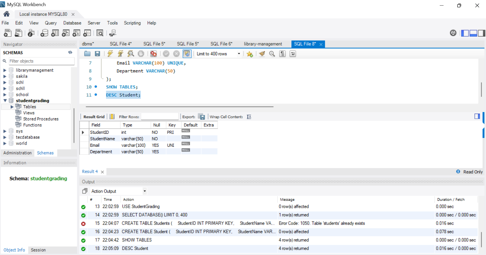
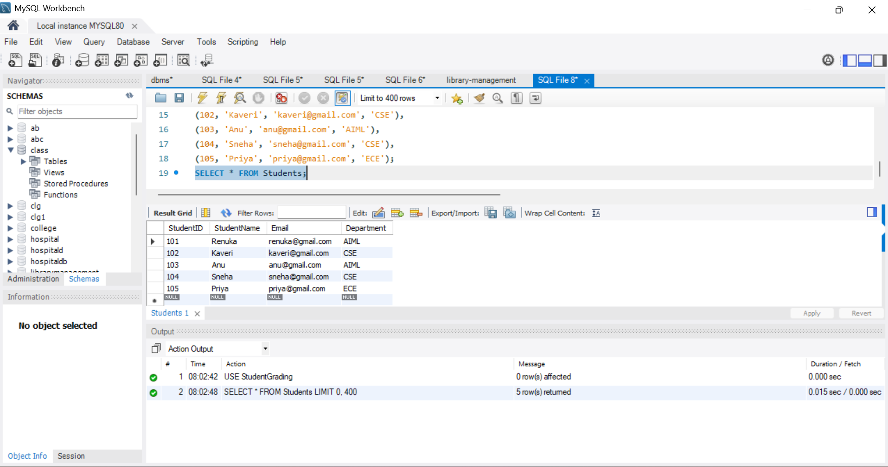
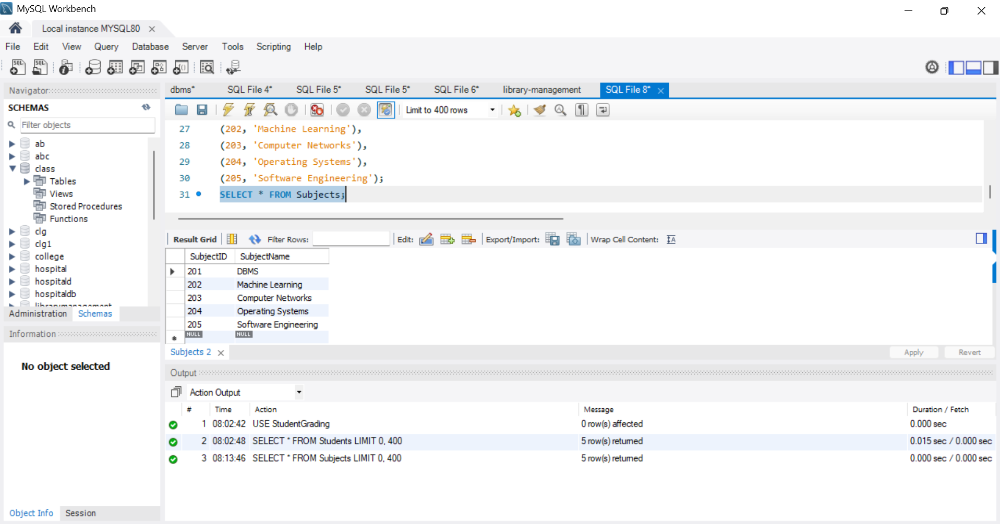
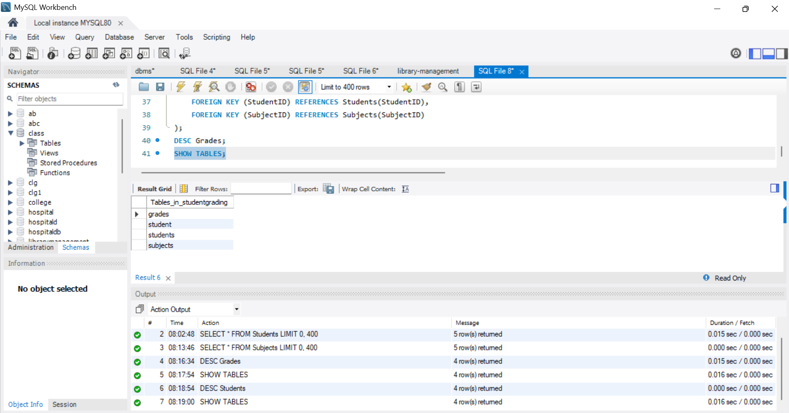
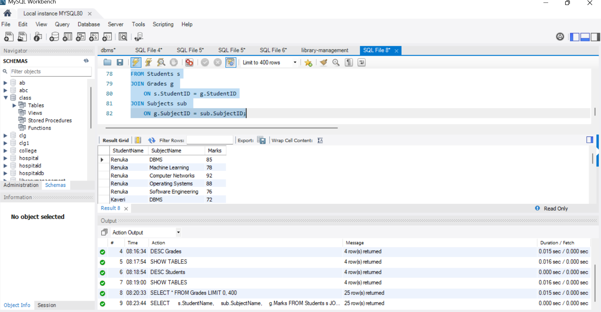
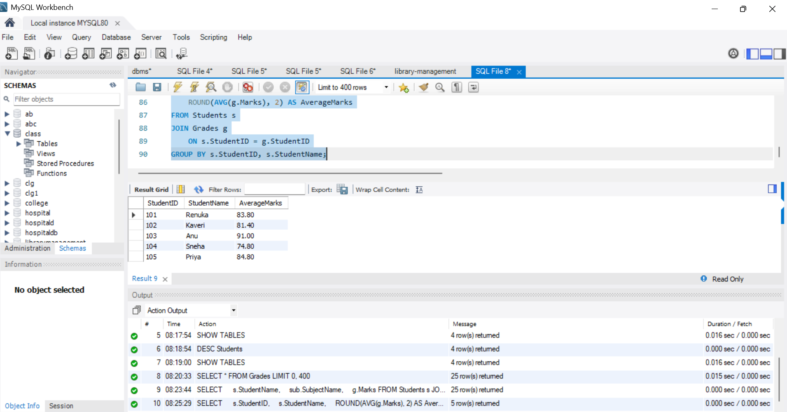
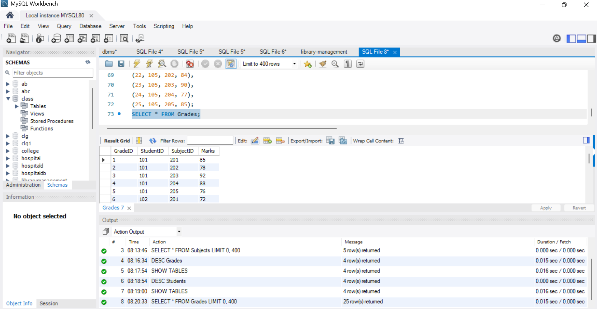
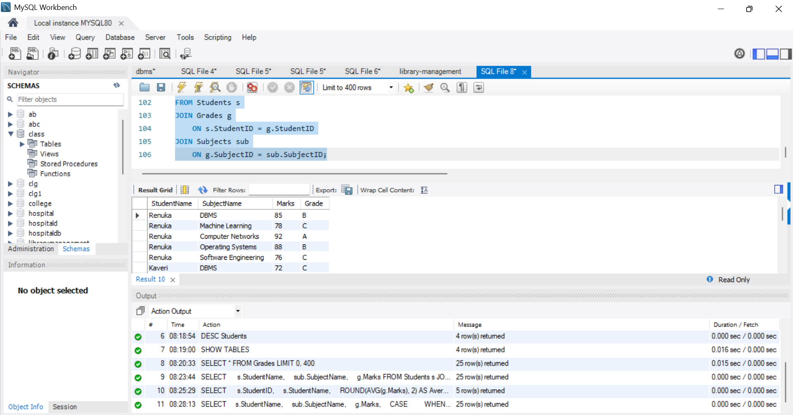
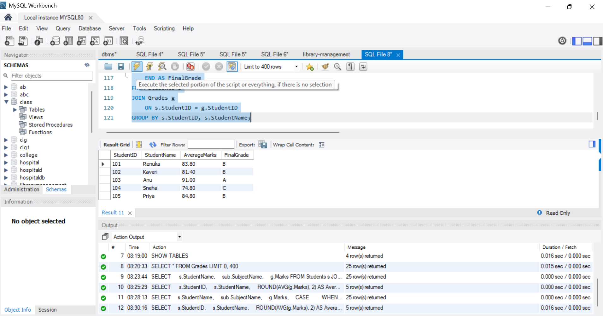

# Student Grading System

## CODTECH IT SOLUTIONS

**Intern Name:** Garnepudi Renuka Rani  
**Domain:** SQL  
**intern id:** CITS8857
**Project Title:** Student Grading System

## Project Description

The Student Grading System is a database management project developed using SQL. It stores student details, subject information, and marks, and generates reports using SQL queries.

## Technologies Used
- MySQL
- SQL
- MySQL Workbench

## Database Tables
- Students
- Subjects
- Grades

## Key Concepts
- Database and table creation
- Inserting and retrieving records
- SQL JOIN operations
- Aggregate functions such as AVG()
- Grade calculation using CASE statements
- Generating student result reports

## Screenshots

### 1. Database Setup

### 2. Student Table

### 3. Subject List

### 4. Tables View

### 5. Marks Report

### 6. Average Report

### 7. Grade Report

### 8. Final Grades

### 9. Final Result

## Outcome

Successfully created a Student Grading System database and practiced SQL queries to retrieve student information, calculate average marks, assign grades, and generate final results.

## Author

**Garnepudi Renuka Rani**
